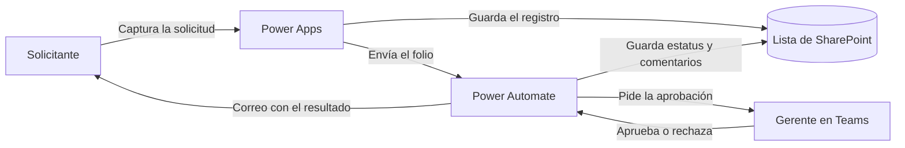

# Sistema de Control de Cambios · Power Apps

Aplicación en **Microsoft Power Apps** para registrar, aprobar y dar seguimiento a las solicitudes de cambio en las máquinas de producción de **Cooper Standard Torreon Plant II**.

**Curso:** Taller de productividad basada en herramientas tecnológicas · Universidad Tecmilenio  
**Equipo:** Camila y Brandon · **Profesor:** José Ramiro De Llano · **Periodo:** agosto – noviembre 2026


## Descripción

La aplicación digitaliza el proceso de control de cambios de la planta. Quien necesita un cambio en una máquina (por ejemplo, modificar un herramental o cambiarla de lugar) lo registra desde Power Apps. La solicitud se guarda en una lista de SharePoint y un flujo de Power Automate la envía al gerente para que la apruebe o la rechace desde Microsoft Teams. La respuesta queda guardada en la misma solicitud, así que en cualquier momento se puede consultar quién pidió el cambio, en qué máquina, con qué prioridad y cuál fue la decisión.

### Enfoque CRM

El proyecto aplica los conceptos de un CRM al proceso de control de cambios:

| Concepto CRM | En esta aplicación |
|---|---|
| Usuarios y responsables | Solicitantes que registran cambios y gerentes que los aprueban |
| Solicitudes e interacciones | Cada solicitud de cambio con sus datos y su evidencia |
| Comunicación automática | Solicitud de aprobación en Teams y correo con el resultado |
| Seguimiento de procesos | Estatus y fecha límite de cada solicitud |
| Historial de solicitudes | Registro de cambios con búsqueda y detalle |

## Funcionalidades

- **Nuevo cambio.** Formulario para capturar la solicitud: fecha, área, máquina, solicitante, número de empleado, descripción, tipo de cambio, prioridad, fecha límite, si requiere aprobación y una imagen como evidencia. El folio se asigna automáticamente al enviar.
- **Aprobación con Power Automate.** Al enviar la solicitud se inicia un flujo que pide la aprobación al gerente y guarda el resultado (aprobado o rechazado) con sus comentarios.
- **Registro de cambios.** Lista de todas las solicitudes con búsqueda por folio o por área.
- **Detalle de cambio.** Todos los datos de una solicitud, incluidos su estatus y los comentarios de aprobación.
- **Dashboard.** Indicadores de total de cambios, pendientes y cerrados (en desarrollo).

## Cómo funciona



1. El solicitante llena la **Solicitud nueva** y presiona **Enviar**.
2. Power Apps guarda la solicitud en la lista de SharePoint, que le asigna un folio.
3. Power Apps inicia el flujo de Power Automate y le envía el folio.
4. El gerente recibe la solicitud en Teams (o por correo) y la aprueba o la rechaza.
5. El flujo guarda la decisión y los comentarios en la solicitud y envía un correo con el resultado.
6. Cualquier usuario puede consultar la solicitud en **Registro de cambios** y ver su estatus en **Detalle de cambio**.

Detalle del flujo: [docs/04-flujo-de-aprobacion.md](docs/04-flujo-de-aprobacion.md)

## Pantallas

| Inicio | Solicitud nueva | Confirmación |
|:---:|:---:|:---:|
|  |  |  |
| **Registro de cambios** | **Detalle de cambio** | **Dashboard** |
|  |  |  |

La descripción de cada pantalla está en [docs/03-pantallas.md](docs/03-pantallas.md) y su código en la carpeta [codigo](codigo/).

## Tecnologías

| Herramienta | Uso |
|---|---|
| Power Apps (aplicación de lienzo) | Pantallas para capturar y consultar las solicitudes |
| Listas de SharePoint | Base de datos de las solicitudes |
| Power Automate | Flujo de aprobación y envío de correos |
| Microsoft Teams y Outlook | Recepción de aprobaciones y notificaciones |
| Notion | Planeación y asignación de tareas del equipo |
| GitHub | Control de versiones y documentación del proyecto |

## Estructura del repositorio

```text
├── README.md                       Descripción general del proyecto
├── capturas/                       Imágenes de cada pantalla
├── codigo/                         Código Power Fx de cada pantalla
│   ├── 01-inicio.md
│   ├── 02-solicitud-nueva.md
│   ├── 03-registro-de-cambios.md
│   ├── 04-detalle-de-cambio.md
│   └── 05-dashboard.md
├── docs/                           Documentación del proyecto
│   ├── 01-requerimientos.md        Requerimientos y su avance
│   ├── 02-modelo-de-datos.md       Lista de SharePoint y modelo entidad-relación
│   ├── 03-pantallas.md             Descripción de cada pantalla
│   ├── 04-flujo-de-aprobacion.md   Flujo de Power Automate
│   ├── 05-manual-de-usuario.md     Guía paso a paso para usuarios
│   └── 06-pruebas.md               Pruebas realizadas
└── solucion/                       Archivo exportado de la aplicación
```

## Cómo instalar la aplicación

1. **Lista de SharePoint.** Crear la lista con las columnas descritas en [docs/02-modelo-de-datos.md](docs/02-modelo-de-datos.md).
2. **Aplicación.** Abrir en Power Apps el archivo de la carpeta [solucion](solucion/) y conectar la lista.
3. **Flujo.** Crear el flujo de aprobación como se explica en [docs/04-flujo-de-aprobacion.md](docs/04-flujo-de-aprobacion.md) y agregarlo a la app.
4. **Publicar.** Guardar, publicar y compartir la app con los usuarios de la planta.

Para usar la aplicación, consulta el [manual de usuario](docs/05-manual-de-usuario.md).

## Estado del proyecto

- [x] Pantalla de inicio y navegación entre pantallas
- [x] Registro de solicitudes con folio automático e imagen de evidencia
- [x] Guardado de las solicitudes en una lista de SharePoint
- [x] Flujo de aprobación con Power Automate y Teams
- [x] Consulta de cambios con búsqueda por folio o área
- [x] Detalle de cada cambio con estatus y comentarios de aprobación
- [ ] Dashboard conectado a los datos
- [ ] Módulo de usuarios y roles
- [ ] Recordatorios de aprobación y vencimiento
- [ ] Exportación a Excel y PDF

El avance de cada requerimiento está en [docs/01-requerimientos.md](docs/01-requerimientos.md) y las pruebas realizadas en [docs/06-pruebas.md](docs/06-pruebas.md).

## Equipo

**Integrantes:** Camila y Brandon

| Rol | Responsabilidad |
|---|---|
| Análisis | Identificar necesidades y requerimientos |
| Desarrollo | Crear la aplicación en Power Apps |
| Automatización | Configurar notificaciones y flujos |
| Base de datos | Organizar y administrar la información |
| Presentación | Documentar y presentar resultados |

---

Proyecto académico desarrollado para la Universidad Tecmilenio.
