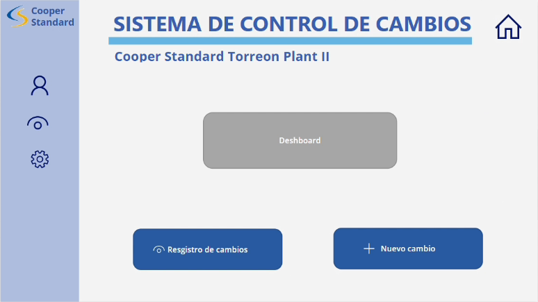

# Pantalla Inicio (`scrHome`)



## Descripción

Menú principal de la aplicación. Desde aquí se abren las demás pantallas.

## Código Power Apps

**Botón "Dashboard" → OnSelect**

```powerfx
Navigate(srcDeshboard, ScreenTransition.Fade)
```

**Botón "Registro de cambios" → OnSelect** (también el ícono de ojo del menú lateral)

```powerfx
Navigate(srcVerCambios, ScreenTransition.Fade)
```

**Botón "Nuevo cambio" → OnSelect**

```powerfx
NewForm(Form2);
Navigate(scrNuevoCambio, ScreenTransition.Fade)
```

**Ícono de casa → OnSelect** (se repite en todas las pantallas)

```powerfx
Navigate(scrHome, ScreenTransition.Fade)
```

## Explicación

**Navigate(pantalla, transición)**
Cambia a la pantalla indicada. `ScreenTransition.Fade` hace que el cambio sea con un desvanecido suave.

**NewForm(Form2)**
Deja el formulario de solicitud vacío y en modo *nuevo*, para que cada vez que se presiona "Nuevo cambio" se empiece una captura limpia.
