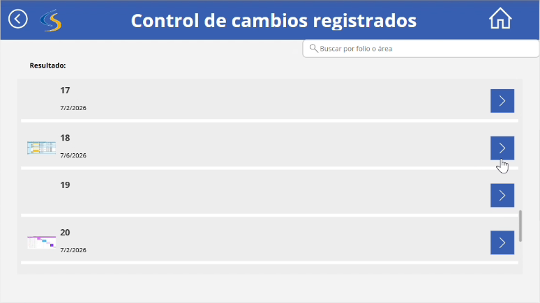

# Pantalla Registro de cambios (`srcVerCambios`)



## Descripción

Muestra todas las solicitudes guardadas en la lista de SharePoint. El buscador filtra por folio o por área, y la flecha de cada solicitud abre su detalle.

## Código Power Apps

### Buscador `txtBuscar` → HintText

```powerfx
"Buscar por folio o área"
```

### Galería `galCambios` → Items

```powerfx
Filter(
    'Control de cambios',
    IsBlank(txtBuscar.Text)
        || Text(ID) = txtBuscar.Text
        || StartsWith(Area.Value, txtBuscar.Text)
)
```

### Elementos de la galería

```powerfx
// Folio → Text
ThisItem.ID

// Fecha → Text
ThisItem.Fecha

// Miniatura → Image
ThisItem.'Agregar imagen'.Full
```

### Galería `galCambios` → OnSelect

```powerfx
Navigate(scrDetalleCambio, ScreenTransition.Fade)
```

La flecha de cada solicitud usa `Select(Parent)`, que ejecuta el `OnSelect` de la galería.

### Flecha de regreso → OnSelect

```powerfx
Navigate(scrHome, ScreenTransition.Fade)
```

## Explicación

**Filter()**
Muestra solo las solicitudes que cumplen la condición:

- Si el buscador está vacío (`IsBlank`), se muestran todas.
- Si se escribe un número, se muestra la solicitud con ese folio (`Text(ID) = txtBuscar.Text`).
- Si se escribe texto, se muestran las solicitudes cuya área empieza con ese texto (`StartsWith`).

**ThisItem**
Representa la solicitud de cada fila de la galería; con él se muestran su folio, su fecha y su imagen.

**galCambios.Selected**
Al tocar una solicitud, la galería la guarda como seleccionada. La pantalla de detalle usa ese valor para saber qué solicitud mostrar.
