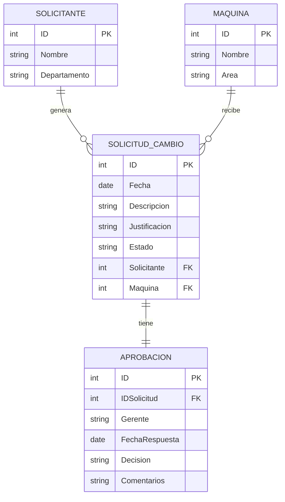

# Modelo de datos

## Dónde se guarda la información

Las solicitudes se guardan en una **lista de SharePoint**. Cada fila de la lista es una solicitud de cambio, y el **ID** que SharePoint asigna automáticamente funciona como folio.

La aprobación se maneja con **Power Automate**: cuando el gerente responde, el flujo escribe la decisión y los comentarios en las columnas **Estatus** y **Comentarios de aprobacion** de la misma solicitud.

## Columnas de la lista

| Columna | Tipo en SharePoint | Uso | Ejemplo |
|---|---|---|---|
| ID | Número (automático) | Folio de la solicitud | 20 |
| Fecha | Fecha | Fecha en que se solicita el cambio | 8/27/2026 |
| Area | Opción | Área de la planta donde está la máquina | BRAZING |
| Maquina | Una línea de texto | Máquina o equipo que se va a modificar | AL-040 |
| Solicitante | Una línea de texto | Nombre de quien pide el cambio | Camila 3022 |
| Numero de empleado | Una línea de texto | Número de nómina del solicitante (se guarda como texto para conservar los ceros iniciales) | 0718 |
| Descripcion del cambio | Texto | Qué se va a cambiar | Cambio de herramental |
| Tipo de cambio | Opción | Clasificación del cambio | Modificacion de herramental |
| Prioridad | Opción | Urgencia del cambio | Media |
| Fecha limite | Fecha | Fecha compromiso para realizar el cambio | 8/28/2026 |
| Requiere aprobacion | Sí/No | Indica si el cambio necesita autorización (Sí por defecto) | Sí |
| Agregar imagen | Imagen | Foto o captura como evidencia | — |
| Estatus | Opción | Resultado de la aprobación; vacío mientras está pendiente | Rechazado |
| Comentarios de aprobacion | Texto | Comentarios que escribe el gerente al responder | flujo |

## Valores de las columnas de opción

| Columna | Valores |
|---|---|
| Area | BRAZING, C1 y las demás áreas de la planta |
| Tipo de cambio | Mecanico · Electrico · Cambio de lugar · Modificacion de pocayoke · Cambio por daño · Mejora en el proceso · Modificacion de base · Modificacion de herramental · Otro |
| Prioridad | Baja · Media · Alta |
| Estatus | Aprobado · Rechazado (vacío = pendiente) |

Como la app toma estas opciones directamente de la lista, para agregar una nueva área o un nuevo tipo de cambio basta con agregarlo en la columna de SharePoint.

## Modelo entidad-relación (Fase 2)

En la Fase 2 se diseñó el siguiente modelo conceptual:

**Relaciones:**

- Un solicitante puede generar varias solicitudes.
- Una máquina puede tener varias solicitudes.
- Cada solicitud tiene una aprobación asociada.

### Diferencias con la versión actual

Para simplificar la primera versión, la aplicación guarda todo en una sola lista:

- **Solicitante** y **Máquina** se capturan como texto dentro de la solicitud, en lugar de tener listas propias.
- **Aprobación** se guarda en las columnas **Estatus** y **Comentarios de aprobacion** de la misma solicitud.

Separar solicitantes, máquinas y aprobaciones en listas propias, como en el modelo de la Fase 2, es una mejora posible para versiones futuras.
