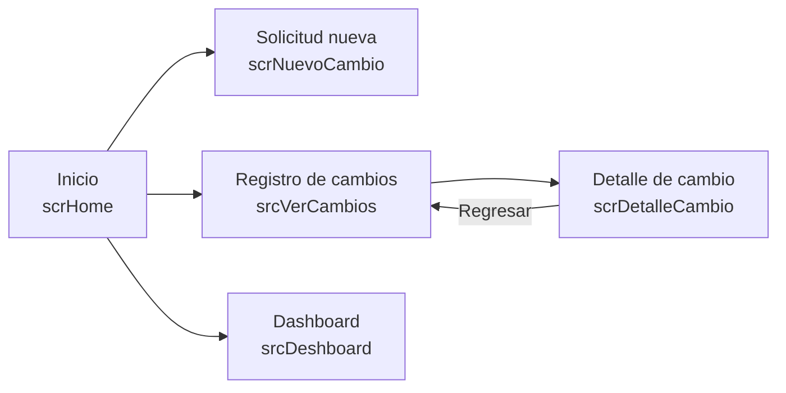
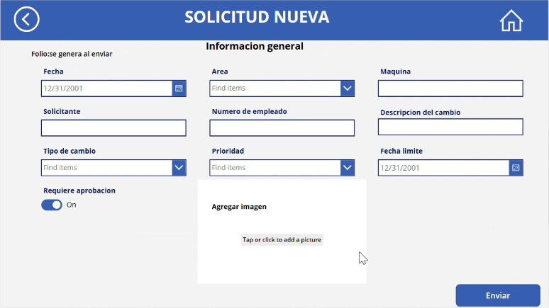
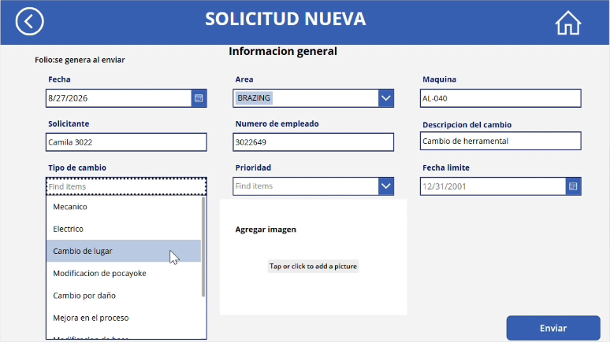
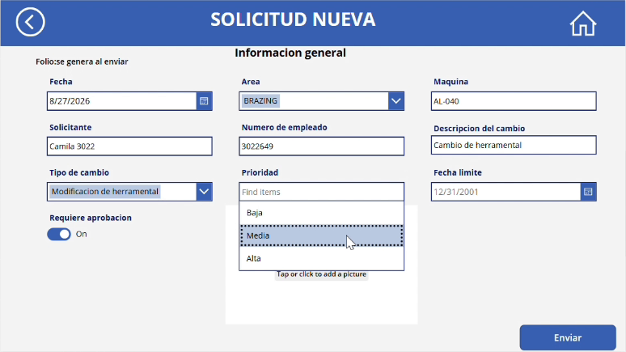
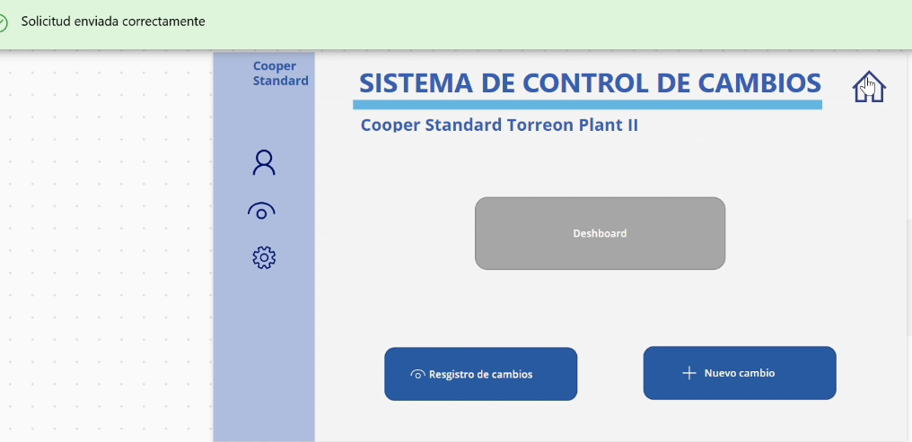
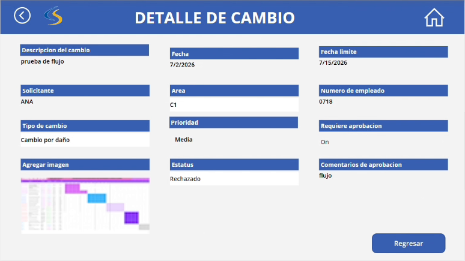
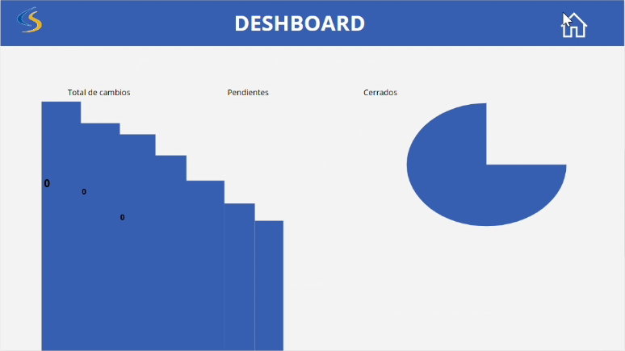

# Pantallas de la aplicación

La aplicación tiene cinco pantallas. Todas comparten un encabezado azul con el logotipo de la planta y un ícono de casa para volver al inicio.

| Pantalla | Nombre en Power Apps | Para qué sirve |
|---|---|---|
| Inicio | `scrHome` | Menú principal |
| Solicitud nueva | `scrNuevoCambio` | Registrar una solicitud de cambio |
| Registro de cambios | `srcVerCambios` | Consultar y buscar solicitudes |
| Detalle de cambio | `scrDetalleCambio` | Ver todos los datos de una solicitud |
| Dashboard | `srcDeshboard` | Indicadores del proceso |

---

## 1. Inicio

- Título **Sistema de Control de Cambios** y nombre de la planta: **Cooper Standard Torreon Plant II**.
- Menú lateral con íconos de usuario, consulta y configuración.
- Botón **Dashboard**: abre los indicadores.
- Botón **Registro de cambios**: abre la lista de solicitudes.
- Botón **Nuevo cambio**: abre el formulario para registrar una solicitud.

Código: [codigo/01-inicio.md](../codigo/01-inicio.md)

---

## 2. Solicitud nueva

Formulario conectado a la lista de SharePoint. El folio no se captura: SharePoint lo asigna al guardar la solicitud.

| Campo | Control | Ejemplo |
|---|---|---|
| Fecha | Calendario | 8/27/2026 |
| Area | Lista desplegable | BRAZING |
| Maquina | Texto | AL-040 |
| Solicitante | Texto | Camila 3022 |
| Numero de empleado | Texto | 3022649 |
| Descripcion del cambio | Texto | Cambio de herramental |
| Tipo de cambio | Lista desplegable | Modificacion de herramental |
| Prioridad | Lista desplegable | Media |
| Fecha limite | Calendario | 8/28/2026 |
| Requiere aprobacion | Interruptor (Sí/No) | Sí |
| Agregar imagen | Imagen | Foto o captura de evidencia |

**Tipos de cambio disponibles:**

**Prioridades disponibles:**

**Solicitud capturada, lista para enviar:**

### Confirmación al enviar

Al presionar **Enviar** ocurren dos cosas:

1. La solicitud se guarda en SharePoint, aparece el mensaje **"Cambio registrado correctamente"** y el formulario se limpia para una nueva captura.
2. Se inicia el flujo de aprobación y aparece el mensaje **"Solicitud enviada correctamente"**.

Código: [codigo/02-solicitud-nueva.md](../codigo/02-solicitud-nueva.md)

---

## 3. Registro de cambios

- Buscador **"Buscar por folio o área"**.
- Lista de solicitudes con folio, fecha y miniatura de la imagen de evidencia.
- La flecha de cada solicitud abre su detalle.

Código: [codigo/03-registro-de-cambios.md](../codigo/03-registro-de-cambios.md)

---

## 4. Detalle de cambio

Muestra la solicitud seleccionada en modo de solo lectura. Los campos **Estatus** y **Comentarios de aprobacion** los llena el flujo de Power Automate cuando el gerente responde; si están vacíos, la solicitud sigue pendiente.

En el ejemplo, la solicitud de prueba fue **rechazada** y el gerente dejó el comentario *"flujo"*.

El botón **Regresar** vuelve al registro de cambios.

Código: [codigo/04-detalle-de-cambio.md](../codigo/04-detalle-de-cambio.md)

---

## 5. Dashboard

Muestra los indicadores **Total de cambios**, **Pendientes** y **Cerrados** con una gráfica de columnas y una gráfica circular. Las gráficas todavía no están conectadas a la lista de SharePoint.

Código para conectarlas: [codigo/05-dashboard.md](../codigo/05-dashboard.md)
