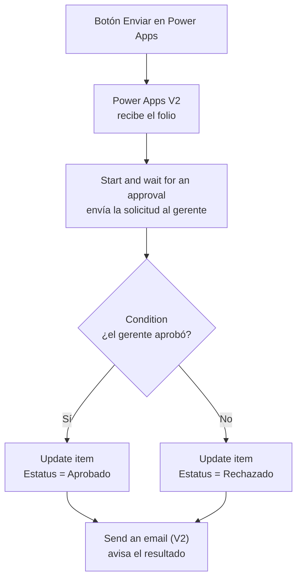

# Flujo de aprobación (Power Automate)

El flujo se encarga de pedir la autorización del gerente y de guardar su respuesta en la solicitud.

- **Nombre en Power Automate:** `PowerAppV2->Startandwaitforanapproval,Condition,Sendanemai...` (nombre generado automáticamente; aquí aparece recortado).
- **Se ejecuta desde:** el botón **Enviar** de la pantalla **Solicitud nueva**.
- **Dato que recibe:** el folio (ID) de la solicitud recién guardada.

## Cómo se llama desde la app

```powerfx
SubmitForm(Form2);

'PowerAppV2->Startandwaitforanapproval,Condition,Sendanemai...'
.Run(Form2.LastSubmit.ID);

Notify(
    "Solicitud enviada correctamente",
    NotificationType.Success
)
```

`Form2.LastSubmit.ID` es el folio que SharePoint asignó a la solicitud que se acaba de guardar. Con ese folio, el flujo sabe qué solicitud debe actualizar.

## Pasos del flujo



| # | Acción | Qué hace |
|:---:|---|---|
| 1 | **Power Apps (V2)** — disparador | Inicia el flujo cuando la app lo llama y recibe el folio de la solicitud. |
| 2 | **Start and wait for an approval** (Iniciar y esperar una aprobación) | Envía la solicitud al gerente. Le llega en Microsoft Teams (aplicación Aprobaciones) y por correo. El flujo espera hasta que responda. |
| 3 | **Condition** (Condición) | Revisa si la respuesta fue *Aprobar* o *Rechazar*. |
| 4 | **Update item** (Actualizar elemento de SharePoint) | Guarda en la solicitud el **Estatus** (Aprobado o Rechazado) y los **Comentarios de aprobacion** que escribió el gerente. |
| 5 | **Send an email (V2)** (Enviar un correo electrónico) | Envía un correo con el resultado de la solicitud. |

## Ejemplo

La solicitud de prueba *"prueba de flujo"* (folio 20) pasó por el flujo: el gerente la rechazó y escribió el comentario *"flujo"*. Ambos datos aparecen en la pantalla **Detalle de cambio**:


## Mejoras sugeridas

- **Usar el interruptor "Requiere aprobacion".** Hoy el flujo se inicia con cada solicitud. Se puede llamar solo cuando el interruptor esté en *Sí* y, si está en *No*, guardar el estatus directamente.
- **Recordatorios.** Agregar un recordatorio al gerente cuando una solicitud lleve varios días sin respuesta o se acerque su fecha límite.
- **Nombre del flujo.** Renombrar el flujo con un nombre corto, por ejemplo `FlujoAprobacionCambios`, para que el código de la app sea más fácil de leer.
