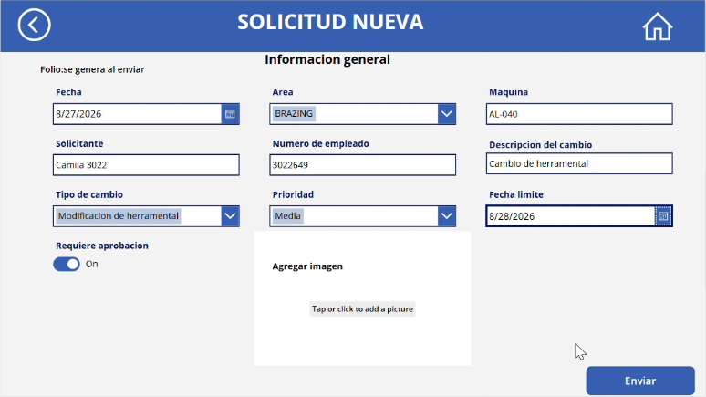

# Manual de usuario

Guía rápida para usar el Sistema de Control de Cambios.

## Antes de empezar

- Necesitas tu cuenta de Microsoft 365 de la empresa.
- Abre la aplicación desde el navegador o desde la app de Power Apps en tu celular o tableta.

## Íconos que se repiten

| Ícono | Función |
|---|---|
| Casa (esquina superior derecha) | Volver a la pantalla de inicio |
| Flecha (esquina superior izquierda) | Regresar a la pantalla anterior |

---

## Registrar un nuevo cambio

1. En la pantalla de inicio, presiona **Nuevo cambio**.
2. Llena los datos de la solicitud:
   - **Fecha** y **Fecha limite:** elígelas con el calendario.
   - **Area**, **Tipo de cambio** y **Prioridad:** elige una opción de la lista.
   - **Maquina**, **Solicitante**, **Numero de empleado** y **Descripcion del cambio:** escríbelos.
   - **Requiere aprobacion:** indica si el cambio necesita autorización del gerente.
   - **Agregar imagen:** sube una foto o captura como evidencia.
3. Presiona **Enviar**.
4. Verás el mensaje **"Cambio registrado correctamente"** y después **"Solicitud enviada correctamente"**. El folio se asigna en automático.
5. Presiona la casa para volver al inicio.

---

## Consultar un cambio

1. En la pantalla de inicio, presiona **Registro de cambios**.
2. Para encontrar una solicitud, escribe su folio o el área en el buscador.
3. Presiona la flecha de la solicitud para ver su detalle.
4. Revisa el **Estatus**:
   - Vacío: la solicitud sigue pendiente de aprobación.
   - **Aprobado:** el gerente autorizó el cambio.
   - **Rechazado:** el gerente no autorizó el cambio.
5. En **Comentarios de aprobacion** puedes ver lo que escribió el gerente.
6. Presiona **Regresar** para volver a la lista.

---

## Aprobar o rechazar una solicitud (gerentes)

1. Recibirás la solicitud en Microsoft Teams (aplicación **Aprobaciones**) y en tu correo.
2. Revisa los datos, elige **Aprobar** o **Rechazar** y escribe un comentario.
3. La decisión se guarda en la solicitud en automático y se envía un correo con el resultado.

---

## Ver los indicadores

En la pantalla de inicio, presiona **Dashboard** para ver el total de cambios, los pendientes y los cerrados.

---

## Preguntas frecuentes

**¿Por qué no aparece el folio mientras lleno el formulario?**
El folio lo asigna SharePoint en el momento en que se guarda la solicitud.

**¿Qué significa que el estatus esté vacío?**
Que el gerente todavía no ha respondido la solicitud.

**¿Puedo buscar por máquina o por solicitante?**
En esta versión, el buscador funciona por folio o por área.
